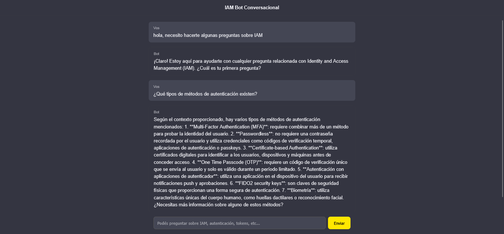
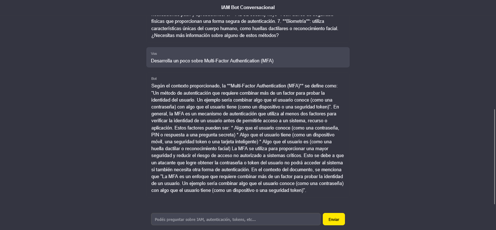
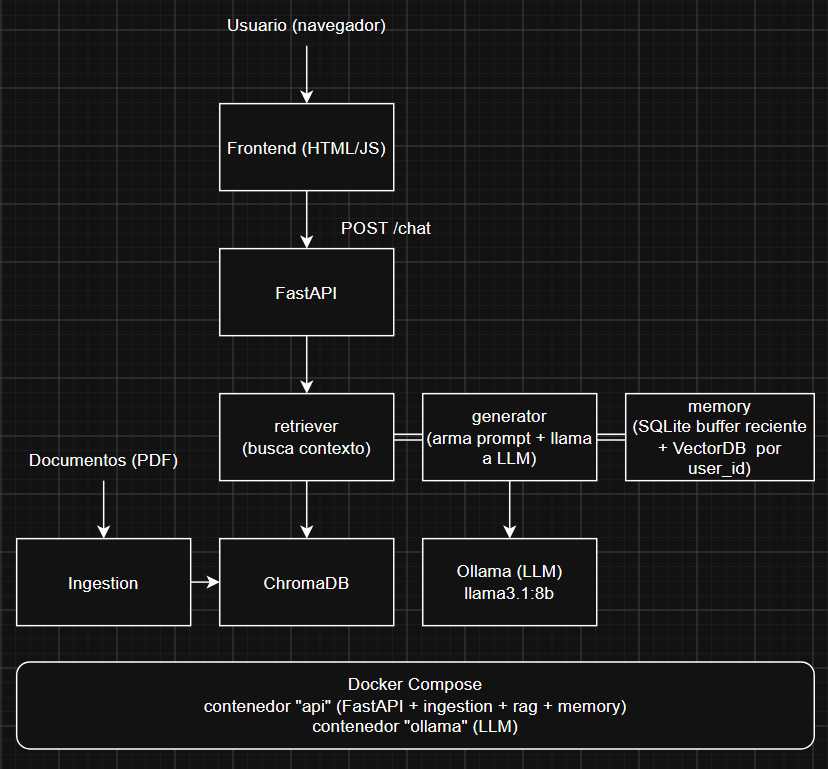

# IAM Support Bot

Bot conversacional para el equipo de IAM (Identity and Access Management), que responde preguntas sobre conceptos y tendencias de protección de cuentas de usuario basándose en un corpus de documentos técnicos. Utiliza un LLM Open Source ejecutado localmente mediante Ollama, combinado con una arquitectura de RAG (Retrieval-Augmented Generation) y memoria conversacional propia.

## Índice

- [Screenshots](#screenshots)
- [Arquitectura](#arquitectura)
- [Cómo ejecutar](#cómo-ejecutar)
- [Decisiones de diseño](#decisiones-de-diseño)
- [Limitaciones conocidas](#limitaciones-conocidas)
- [Pruebas conversacionales y resultados](#pruebas-conversacionales-y-resultados)

## Screenshots





## Arquitectura

El sistema implementa una arquitectura RAG con memoria conversacional híbrida. La API coordina tres fuentes de contexto antes de llamar al LLM:

1. **Contexto documental:** fragmentos recuperados desde el corpus IAM indexado en ChromaDB.
2. **Memoria reciente:** últimos intercambios del usuario almacenados cronológicamente en SQLite.
3. **Memoria semántica:** intercambios anteriores recuperados por similitud desde una colección independiente de ChromaDB.



### Módulos del proyecto

| Carpeta | Responsabilidad |
|---|---|
| `ingestion/` | Extracción de texto de los PDFs, limpieza, chunking, generación de embeddings e indexación del corpus documental en ChromaDB. |
| `rag/` | Recuperación semántica y léxica, filtrado por relevancia, construcción del prompt, llamada al LLM y orquestación general del flujo. |
| `memory/` | Memoria conversacional híbrida: Buffer persistente en SQLite, memoria semántica en ChromaDB y combinación de ambas estrategias. |
| `api/` | Definición del endpoint HTTP `/chat` y de los modelos de request y response. |
| `config/` | Configuración centralizada mediante variables de entorno. |
| `frontend/` | Interfaz web en HTML, CSS y JavaScript, servida directamente por FastAPI. |
| `data/` | PDFs originales, base vectorial persistente y base SQLite de memoria conversacional. |
| `tests/` | Pruebas del comportamiento fuera de dominio, búsqueda léxica y memoria híbrida. |

### Stack tecnológico

- **API:** FastAPI + Uvicorn.
- **LLM:** Ollama con `llama3.1:8b` como modelo por defecto.
- **Embeddings:** `sentence-transformers` con `paraphrase-multilingual-MiniLM-L12-v2`.
- **Corpus RAG:** colección `documentos_iam` en ChromaDB.
- **Memoria reciente:** SQLite, separada por `user_id`.
- **Memoria semántica:** colección `memoria_conversacional` en ChromaDB, filtrada por `user_id`.
- **Frontend:** HTML, CSS y JavaScript sin frameworks.
- **Contenedores:** Docker y Docker Compose.

### Flujo de una consulta

1. El frontend envía la pregunta y el `user_id` mediante `POST /chat`.
2. FastAPI delega el procesamiento al pipeline.
3. La memoria híbrida recupera:
   - los últimos turnos desde SQLite;
   - intercambios anteriores relacionados desde ChromaDB.
4. El retriever ejecuta una búsqueda semántica sobre el corpus documental.
5. Si la pregunta contiene una sigla, se agrega una búsqueda léxica directa sobre los documentos.
6. Los resultados se filtran y deduplican.
7. El generator construye un prompt que separa explícitamente:
   - contexto documental;
   - memoria conversacional;
   - historial reciente.
8. Ollama genera la respuesta.
9. El intercambio se persiste en SQLite y, cuando corresponde, en la memoria vectorial.

## Cómo ejecutar

### Requisitos previos

- Python 3.10+
- Docker Desktop (o Docker Engine + Compose)
- [Ollama](https://ollama.com/download) (necesario solo si se ejecuta sin Docker)
- Un modelo descargado en Ollama:
  ```bash
  ollama pull llama3.1:8b
  ```

Crear un archivo `.env` en la raíz del proyecto tomando como referencia `.env.example`:

```env
# --- LLM local ---
OLLAMA_MODEL=llama3.1:8b
OLLAMA_HOST=http://localhost:11434

# --- Documentos y persistencia ---
DOCUMENTS_PATH=./data/documents
VECTORSTORE_PATH=./data/vectorstore

# --- Recuperación documental RAG ---
RAG_TOP_K=4
RAG_MAX_DISTANCE=0.75

# --- Memoria Buffer en SQLite ---
MEMORY_SQLITE_PATH=./data/memoria.db
MEMORY_BUFFER_TURNS=5

# --- Memoria vectorial en ChromaDB ---
MEMORY_VECTOR_COLLECTION=memoria_conversacional
MEMORY_VECTOR_TOP_K=3
MEMORY_VECTOR_MAX_DISTANCE=0.75
```

Colocar los documentos PDF en:

```text
data/documents/
```

El archivo `.env` no debe versionarse. El repositorio incluye un `.env.example` con las variables requeridas y sin información sensible.

### Ejecución con Docker Compose 

Requiere Docker Desktop instalado y corriendo.

```bash
docker compose up -d --build
```

La primera vez, bajar el modelo dentro del contenedor de Ollama:
```bash
docker compose exec ollama ollama pull llama3.1:8b
```

E indexar los documentos dentro del contenedor:
```bash
docker compose exec api python -m ingestion.run_ingestion
```

La API queda disponible igual que en la ejecución manual, en `http://localhost:8000`, y el frontend en `http://localhost:8000/app`.

Para pausar sin perder el modelo descargado ni los contenedores construidos:
```bash
docker compose stop     # pausa
docker compose start    # retoma
```


### Instalación sin docker (Alternativa)

```bash
python -m venv .venv
.venv\Scripts\activate       # Windows
pip install -r requirements.txt --break-system-packages
```

### Indexar los documentos

```bash
python -m ingestion.run_ingestion
```

Esto genera los embeddings de todos los documentos y los persiste en `data/vectorstore/`. Solo es necesario correrlo una vez, o cada vez que se agreguen o modifiquen documentos.

### Levantar la API

```bash
uvicorn main:app --reload
```

La API queda disponible en `http://localhost:8000`, con documentación interactiva (Swagger) en `http://localhost:8000/docs`.

### Probar el bot

**Vía Frontend:** `http://localhost:8000/app`

**Vía Swagger:** entrar a `/docs`, desplegar `POST /chat`, usar "Try it out".

## Decisiones de diseño

### RAG en lugar de fine-tuning

La consigna pide "entrenar un LLM con la información de los documentos". Se optó por **RAG (Retrieval-Augmented Generation)** en lugar de fine-tuning de los pesos del modelo, por varias razones:

- Fine-tuning requiere recursos de cómputo (GPU) significativamente mayores, no disponibles en el entorno de desarrollo.
- RAG permite actualizar el conocimiento del bot simplemente re-indexando documentos, sin reentrenar nada — más apropiado para un caso de uso donde los documentos de referencia pueden cambiar.
- Reduce el riesgo de alucinación: el modelo responde en base a texto recuperado explícitamente, no a lo que "memorizó" durante un entrenamiento.

### Chunking: de párrafos a oraciones completas

Se probaron tres estrategias de chunking, iterando sobre los resultados:

1. **Chunking por tamaño fijo de palabras:** simple, pero corta ideas a la mitad sin ningún criterio.
2. **Chunking por párrafos (`\n\n`):** falló en la práctica porque los PDFs del corpus no preservan saltos de línea dobles de forma confiable al extraer el texto (`pypdf` concatena líneas de forma continua) — en varios documentos, todo el texto quedaba interpretado como un único "párrafo" gigante.
3. **Chunking por oraciones completas (solución final):** se acumulan oraciones completas hasta acercarse a un límite de ~400 palabras, con overlap de 2 oraciones entre chunks consecutivos. Esto garantiza que ningún chunk corte una idea a la mitad, independientemente de cómo esté formateado el PDF original.

### Limpieza de texto antes de chunkear

Se detectó que las tablas de contenido de los PDFs (líneas tipo `TERMINOLOGY....4`) se colaban como texto dentro de los primeros chunks, diluyendo el embedding con ruido no semántico. Se agregó un paso de limpieza (`limpiar_texto`) que descarta líneas con secuencias de 4 o más puntos seguidos, antes de chunkear.

### Métrica de similitud: coseno en lugar de distancia euclidiana (L2)

ChromaDB usa distancia euclidiana (L2) por defecto, que no tiene un rango acotado y es difícil de interpretar o de usar como umbral de corte. Se configuró explícitamente la colección para usar **similitud coseno** (`metadata={"hnsw:space": "cosine"}`), que produce valores interpretables (cercano a 0 = muy similar) y es el estándar para comparar embeddings de texto.

### Grounding del LLM (reducir riesgo de alucinaciones)

El prompt de sistema instruye explícitamente al modelo a responder únicamente en base al contexto recuperado, y a indicar cuando no tiene información suficiente en lugar de inventar una respuesta. 

Se reforzó el grounding con una segunda capa de seguridad a nivel código, no solo de prompt: si la respuesta generada comienza indicando que no hay información suficiente, se descarta cualquier texto adicional que el modelo agregue después (evitando que complete igual con conocimiento general), devolviendo únicamente el mensaje canónico de "no tengo información suficiente".

### Memoria conversacional híbrida Buffer + Vectorial:

la solución combina una memoria reciente persistida en SQLite con una memoria semántica persistida en una colección independiente de ChromaDB. SQLite recupera los últimos N turnos en orden cronológico, mientras que ChromaDB permite recuperar intercambios anteriores según su similitud con la consulta actual. Cada registro vectorial contiene un intercambio completo y metadata con el user_id; todas las consultas vectoriales se filtran por ese identificador para garantizar el aislamiento entre conversaciones. Los resultados presentes en el Buffer se eliminan de la memoria vectorial recuperada para evitar duplicados. La memoria conversacional se utiliza únicamente para interpretar el seguimiento de la conversación; las respuestas técnicas continúan fundamentándose en el corpus documental del RAG.

### Optimización de inferencia en CPU

Al no contar con GPU dedicada, se ajustaron parámetros de generación del LLM para reducir la latencia por respuesta:

- **`num_predict=400`**: limita la cantidad máxima de tokens que el modelo puede generar por respuesta. Este es el ajuste con mayor impacto real en el tiempo de respuesta — cada token generado tiene un costo de cómputo fijo (medido en los logs de Ollama en ~5-6 tokens/segundo en CPU para `llama3.1:8b`), por lo que acotar el largo máximo de la respuesta reduce directamente el tiempo total, a costa de eventualmente cortar una respuesta muy extensa.
- **`temperature=0.0`**: se evaluó inicialmente como optimización de velocidad, pero se confirmó que **no acelera la generación** — la temperatura controla la aleatoriedad del muestreo de tokens, no la cantidad de cómputo realizado. Se mantuvo en `0.0` igualmente, pero por otro motivo: mayor determinismo entre corridas, lo cual resultó valioso para la reproducibilidad de las pruebas conversacionales documentadas en este README (respuestas más consistentes ante la misma pregunta repetida).

### Manejo de dependencias async/sync en FastAPI

El endpoint `/chat` está declarado como `async`, pero la lógica interna (retriever, LLM, SQLite) es sincrónica y potencialmente bloqueante. Se utiliza `run_in_threadpool` para ejecutar esa lógica en un thread separado, evitando que bloquee el event loop de FastAPI ante múltiples requests concurrentes.

### Búsqueda híbrida para siglas y acrónimos cortos

El sistema utiliza una estrategia de recuperación híbrida. Todas las preguntas ejecutan inicialmente una búsqueda semántica sobre ChromaDB. Cuando la consulta contiene una sigla de entre dos y cinco letras mayúsculas, como AAA, IAM, MFA, SSO o PKCE, el pipeline ejecuta además una búsqueda léxica directa sobre los documentos originales.

Esta búsqueda complementaria se invoca desde procesar_mensaje() y llama a buscar_por_keyword() por cada sigla detectada. Los resultados semánticos y léxicos son combinados y deduplicados antes de construir el contexto enviado al LLM. La estrategia fue incorporada porque las siglas cortas suelen aportar poca información semántica al modelo de embeddings.

### Frontend propio en lugar de chat-ui

La consigna sugiere `chat-ui` como opción para el frontend. Se evaluó y se decidió no adoptarlo tal cual, por una diferencia de alcance significativa respecto al resto del proyecto: `chat-ui` está construido en SvelteKit (stack de JavaScript distinto al resto del proyecto, en Python), y espera una base de datos MongoDB para persistir conversaciones — dos dependencias nuevas que no aportan valor proporcional al tiempo que tomaría integrarlas, dado que la memoria conversacional del bot ya está resuelta del lado del backend.

En su lugar, se optó por un **frontend propio, minimalista** (HTML + CSS + JavaScript vanilla, sin frameworks), servido directamente desde la misma API de FastAPI mediante archivos estáticos (`app.mount(...)`). Con estética de burbujas de chat similar a ChatGPT. Ventajas de este enfoque:

- Cero dependencias nuevas (no requiere Node.js, npm, ni una base de datos adicional).
- Reutiliza el endpoint `/chat` existente sin modificaciones ni adaptación de protocolo.
- Cada sesión de navegador genera un `user_id` aleatorio propio al cargar la página, aprovechando la separación de memoria por usuario ya implementada en el backend — sin necesidad de un sistema de login.

### Deploy web no implementado

Se evaluaron las opciones sugeridas por la consigna (AWS, GCP, fly.io, Vercel). Vercel se descartó por incompatibilidad de modelo de ejecución: es una plataforma serverless orientada a funciones de corta duración, y no sostiene procesos persistentes como requiere Ollama con un modelo cargado en memoria. De las opciones restantes, fly.io es la más compatible con la arquitectura ya containerizada del proyecto (Docker Compose), pero correr un modelo de 7-8B de forma sostenida requiere un plan pago (los tiers gratuitos de fly.io, AWS y GCP no ofrecen suficiente RAM para este caso), representando un costo económico recurrente no justificado para el alcance de este challenge. Se priorizó, en el tiempo disponible, profundizar en la solidez del backend, el RAG, y la corrección de las respuestas del bot, por sobre incurrir en un costo de infraestructura cloud para una demo puntual. La aplicación queda completamente funcional y reproducible localmente vía Docker Compose (ver sección "Cómo ejecutar"), lista para desplegarse en cualquiera de estas plataformas si se dispusiera de presupuesto para el tier con RAM suficiente.

## Limitaciones conocidas

### Ejecución en CPU

El entorno de desarrollo no cuenta con GPU dedicada, por lo que el LLM corre sobre CPU vía Ollama. Esto es funcional pero introduce latencia (varios segundos por respuesta) que sería menor en un entorno con GPU o usando un modelo más liviano.

### Límite de memoria de Ollama dentro de Docker

Al correr Ollama dentro de un contenedor gestionado por WSL2, el proceso solo tiene visibilidad de una porción de la RAM total del host (11.7 GiB observados, sobre 32GB físicos disponibles) — es el límite de memoria que Docker Desktop asigna a WSL2 por defecto, no un límite de la aplicación en sí. No representó un problema para `llama3.1:8b`, pero es un punto a tener en cuenta si se quisiera correr un modelo más grande dentro de Docker: el límite es ajustable en Docker Desktop → Settings → Resources → Memory.

## Pruebas conversacionales y resultados

Se ejecutó un set de 10 preguntas contra el endpoint `/chat`, cubriendo la mayoría de los documentos del corpus y un caso negativo (pregunta fuera de dominio), con `user_id` distintos para evitar interferencia de memoria entre pruebas.

| # | Pregunta | Documento esperado | Resultado |
|---|---|---|---|
| 1 | ¿Qué tipos de métodos de autenticación existen? | TiposDeAutenticacion.pdf | ✅ Correcto y completo |
| 2 | ¿Por qué no es recomendable tener token de sesión con fecha de expiración grande? | BuenasPracticasTiempoDeSesion2025.pdf | ✅ Correcto y completo |
| 3 | ¿Qué significa AAA? | AccessControl.pdf | ✅ Correcto |
| 4 | ¿Qué es PKCE y para qué sirve? | PKCE.pdf | ✅ Correcto |
| 5 | ¿Qué diferencia hay entre autenticación y autorización? | Autenticacion+Autorizacion.pdf | ✅ Correcto, combinó bien dos fuentes |
| 6 | ¿Qué es OpenID Connect y en qué se diferencia de OAuth? | OpenIDC.pdf | ✅ Correcto y completo |
| 7 | ¿Qué fases tiene el ciclo de vida de una identidad? | LifeCycle.pdf | ✅ Correcto, distinguió ciclo de cliente vs. trabajador |
| 8 | ¿Qué es el user provisioning? | UserProvisioning.pdf | ✅ Correcto |
| 9 | ¿Qué es un ataque de replay de tokens? | BuenasPracticasTiempoDeSesion2025.pdf | ✅ Correcto |
| 10 | ¿Cuál es la capital de Francia? (caso negativo, fuera de dominio) | — | ✅ Rechazó correctamente responder |

**Prueba de memoria conversacional:** se validó adicionalmente una conversación de dos turnos, donde la segunda pregunta ("¿y ese tipo de token es más o menos seguro que uno de corta duración?") solo tiene sentido en conjunto con la primera ("¿qué es un refresh token?"). El bot respondió correctamente utilizando el contexto del turno anterior, confirmando que la memoria conversacional funciona de punta a punta. Se validó también que conversaciones con distinto `user_id` no comparten historial entre sí.

## Benchmark de modelos

Se comparó el mismo set de 5 preguntas (subconjunto del set de pruebas anterior) ejecutado contra tres modelos Open Source distintos, corriendo en CPU vía Ollama, midiendo tiempo de respuesta:

| Modelo | Tamaño | Tiempo promedio | Rango (min-max) |
|---|---|---|---|
| `llama3.2:3b` | 3B parámetros | **36.5s** | 24.5s - 44.8s |
| `llama3.1:8b` | 8B parámetros | 79.7s | 44.0s - 125.7s |
| `mistral:7b` | 7B parámetros | 99.3s | 62.5s - 158.0s |

**Observaciones:**

- `llama3.2:3b` resultó más del doble de rápido que los otros dos modelos, consistente con ser el más chico de los tres — es el candidato natural si se prioriza latencia sobre profundidad de respuesta (por ejemplo, para una demo interactiva).
- `mistral:7b`, a pesar de tener menos parámetros que `llama3.1:8b`, resultó el más lento del grupo. Esto contradice la intuición de que un modelo más chico es siempre más rápido
- Cualitativamente, las respuestas de `llama3.2:3b` fueron notablemente más cortas (promedio de ~730 caracteres) que las de `mistral:7b` (~850 caracteres) y `llama3.1:8b` (~690 caracteres, aunque afectado por la respuesta corta de la pregunta de AAA que el modelo no pudo responder). No se observó una degradación evidente en la corrección de las respuestas del modelo más chico para este set de preguntas, aunque el análisis fue cualitativo, no una evaluación automatizada de exactitud.
- **Recomendación:** para el caso de uso de este bot , `llama3.1:8b` sigue siendo el default razonable por su balance entre calidad y velocidad. Para escenarios donde la latencia es más crítica que el detalle de la respuesta, `llama3.2:3b` es la alternativa a considerar.

Resultados completos (con el texto de cada respuesta) disponibles en `benchmark_resultados.json`, generado por `tests/benchmark_modelos.py`.

### Estado de los requerimientos

| Requerimiento | Estado | Implementación |
|---|---|---|
| API en Python | Cumplido | FastAPI + Uvicorn |
| LLM Open Source | Cumplido | Llama ejecutado localmente mediante Ollama |
| Conocimiento documental | Cumplido | RAG sobre PDFs indexados en ChromaDB |
| Memoria administrada por la API | Cumplido | Implementación propia sin memoria nativa del LLM |
| Documentación | Cumplido | README, decisiones de diseño, pruebas y diagrama de arquitectura |
| RAG | Cumplido | Búsqueda semántica, filtrado por distancia y grounding |
| VectorDB para memoria | Cumplido | Memoria híbrida: Buffer SQLite + colección independiente de ChromaDB |
| Documentación técnica | Cumplido | Arquitectura, módulos, flujo y decisiones de diseño |
| Frontend estilo chat | Cumplido | HTML, CSS y JavaScript servidos por FastAPI |
| Deploy web | No implementado | Justificación técnica y económica documentada |
| Benchmark de modelos | Cumplido | Comparación de tres modelos ejecutados mediante Ollama |
| Comparación de estrategias de memoria | Parcialmente cumplido | Se implementó una estrategia híbrida Buffer + Vectorial; Summary no fue implementada |
| Dockerización | Cumplido | Dockerfile + Docker Compose |